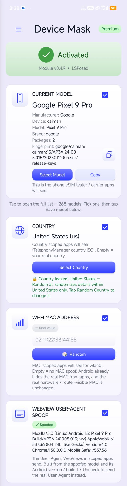
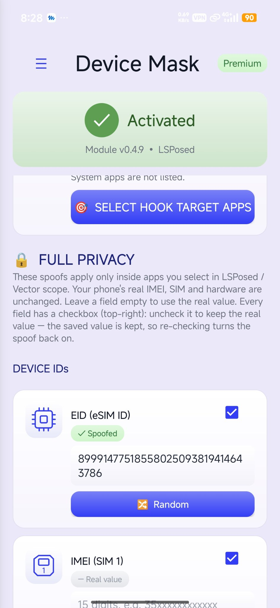
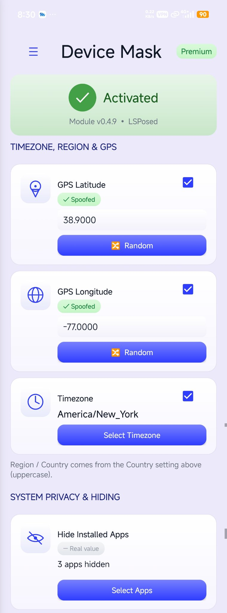
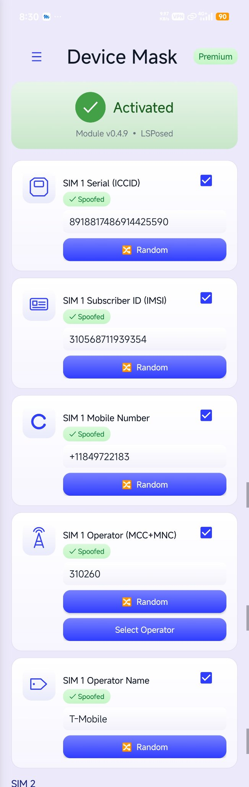

# Device Mask

**Device Mask** is an LSPosed module that lets selected apps see a different
device identity — model, manufacturer, country, operator, timezone, EID and
SIM details — while the real device stays untouched. It is display-only
spoofing: the checker or tester app shows the chosen values, the real eSIM,
hardware, SIM and system values are never changed.

- Package: `com.device.mask`
- Current version: **1.0.24** (versionCode 65)
- Hook version: **0.4.9** (the LSPosed module marker)
- Requires: rooted Android (KernelSU or Magisk) + LSPosed, Android 10+

## What you can do with it

- **Spoof your device** — make any selected app see a different phone:
  model, manufacturer, brand, fingerprint and codename, from 268+
  real models.
- **Spoof your location and country** — GPS coordinates, country and
  timezone follow the country you pick (118 countries).
- **Spoof your network** — operator, operator name, MCC/MNC, SIM serial
  (ICCID), IMSI and phone number, per SIM.
- **Spoof your EID** — the eSIM identifier shown to apps can be changed
  to the one that belongs to the chosen device.
- **Enable eSIM support** — apps that check whether the device supports
  eSIM see it as supported, so eSIM features and testers work on any
  app you choose.
- **Spoof the rest too** — IMEI, MAC address, WebView user-agent and
  more, each with its own on/off switch, so you only change what you
  want to change.

Everything above is display-only: the chosen app sees the spoofed
values, while your real device, SIM and eSIM stay exactly as they are.

## Features

- **268 device models** across all major brands (Samsung, Pixel, OnePlus,
  Xiaomi, Vivo, OPPO, Huawei, iPhone, ROG, and more), each with its real
  fingerprint, codename and CPU/GPU where known.
- **118 countries** with operators, dial codes, timezones and GPS
  coordinates — pick a country and the operator, timezone and GPS follow.
- **Per-function toggles** — every spoofed field (model, country,
  operator, timezone, EID, IMEI/IMSI/ICCID, phone number, MAC, WebView
  user-agent, …) can be switched on or off individually.
- **Random all** — one tap randomises model, country and operator.
- **Hook Target picker** — the module only runs in the apps you tick in
  LSPosed scope.
- **Activation card** — the header shows whether the module actually ran
  in this boot (green *Activated* / red *Module is inactive*), proven by
  three independent channels (property marker, provider health report,
  marker file).
- **Diagnose** — a built-in diagnostic screen that shows the operator
  values by channel, so a mismatch can be traced instead of guessed.
- **Premium** — a free tier (10 models, 10 countries) and a premium tier
  (everything, incl. timezone, EID and all mobile-network options) with
  login, free trial, redeem codes and server-side verification. The
  premium backend is **not** part of this repository — the app talks to
  it over HTTPS, and every premium use is re-verified with the server
  so a modded client cannot unlock premium offline.

## Screenshots

| Main | Privacy & Device IDs | Timezone & GPS | SIM 1 |
| --- | --- | --- | --- |
|  |  |  |  |

More screenshots in the [`screenshots/`](screenshots/) folder.

## Installation

1. Install the APK (see
   [Releases](https://github.com/SnzLabs/device-mask/releases)).
2. Enable **Device Mask** in LSPosed and tick the apps it should run in
   (e.g. your checker app).
3. Reboot (only needed the first time you enable the module).
4. Open Device Mask, pick a model and a country, save, then force-stop
   the target app and re-check it. Model changes after that apply live
   — no reboot needed.

## Build from source

Gradle is not used — the module is built with the manual script in
`build-manual/` (kotlinc → aapt2 → d8 → zipalign → apksigner), which is
also how every release was built. You need Android SDK platform
`android-36`, build-tools `36.0.0`, Temurin JDK 17 and kotlinc 2.1.20,
plus the LSPosed API 101 AAR (`api-101.0.0.aar`) for `classes.jar`.

```sh
bash build-manual/build-pro.sh
# → Device-Mask-vX.Y.Z.apk (signed with the debug key in build-manual/)
```

> The release APKs are signed with the project's debug key. If you
> build it yourself, sign it with your own key — and note that the
> app's signature check (`EXPECTED_SIGNATURE_SHA256`) must match the
> key you sign with, or the app will refuse to open.

## License

MIT — see [LICENSE](LICENSE).

## Disclaimer

Device Mask is a privacy and testing tool. It only changes what a
chosen app *displays*; it does not change the real device, SIM or
eSIM. Do not use it to misrepresent a device to a service that
requires a genuine attestation.
